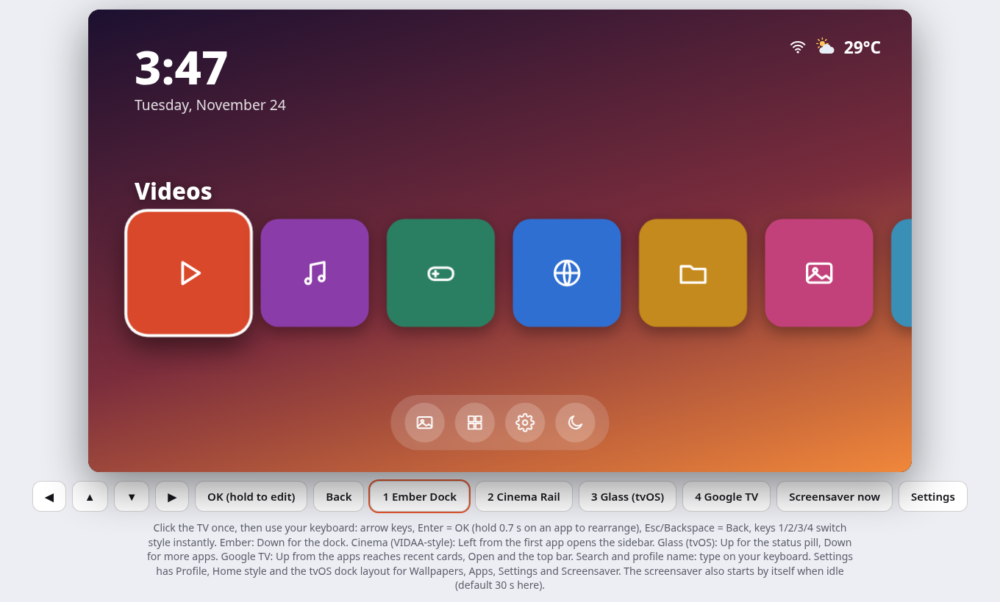
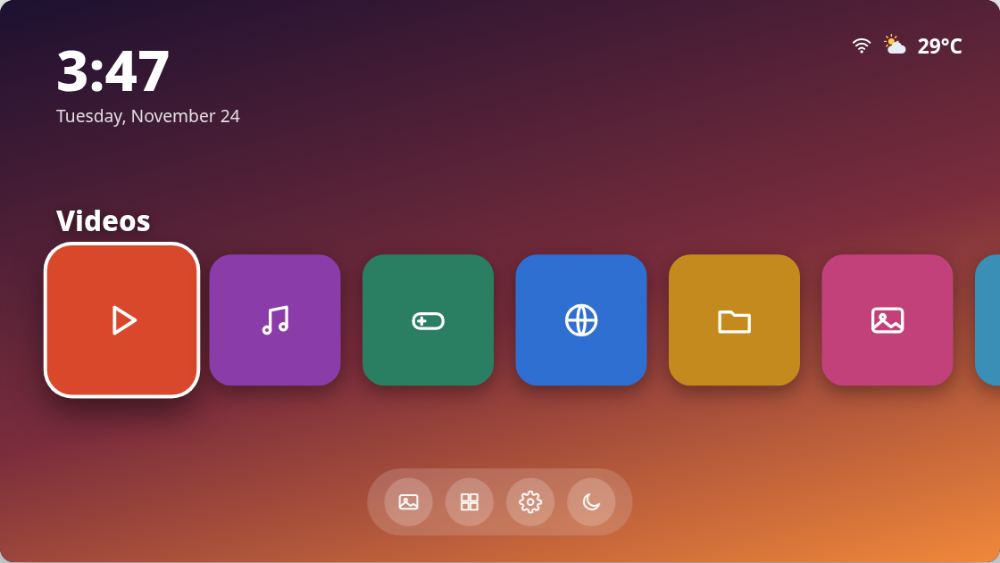
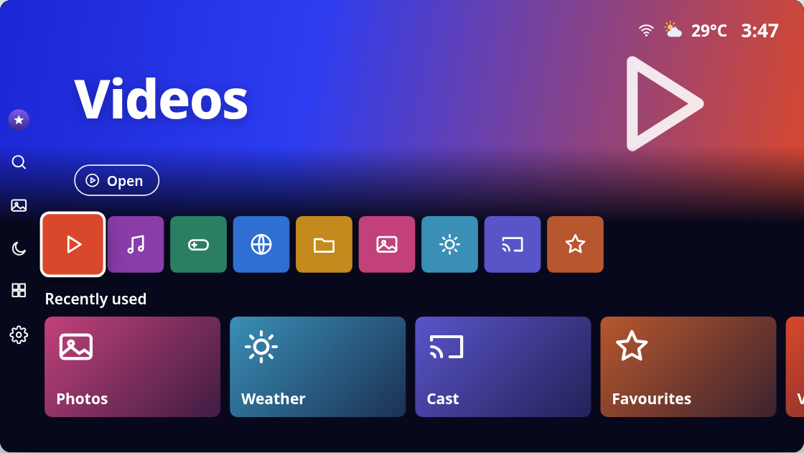
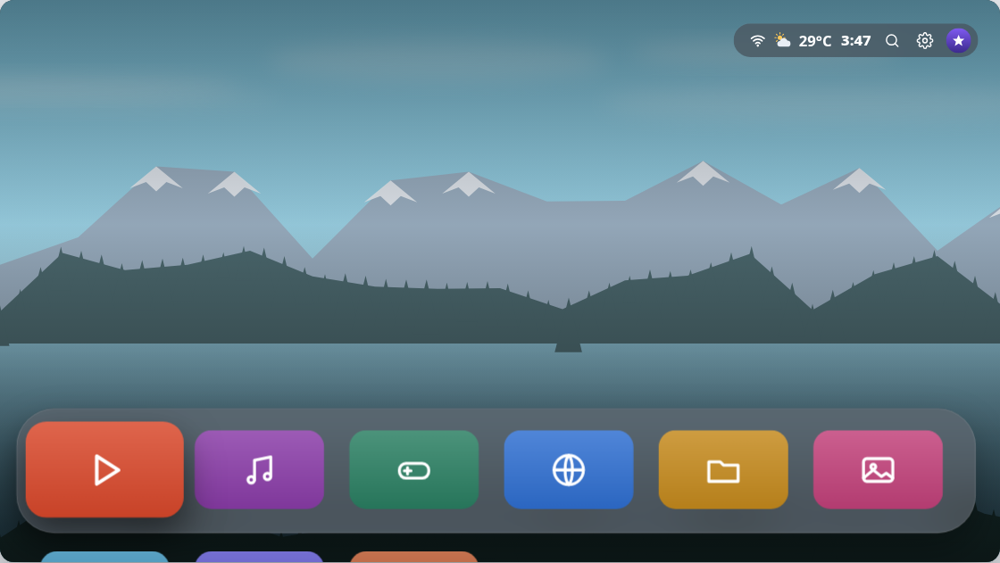
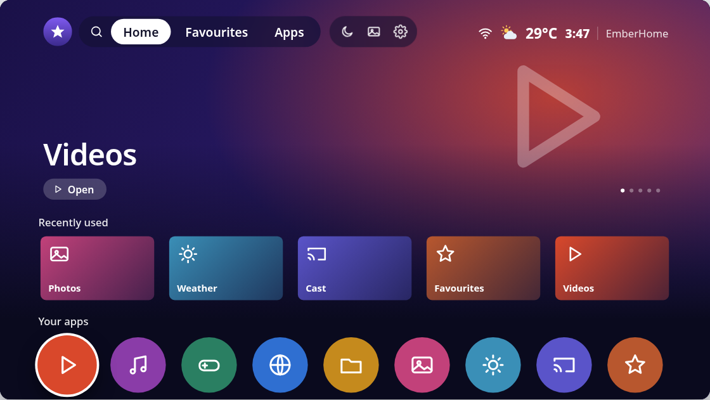
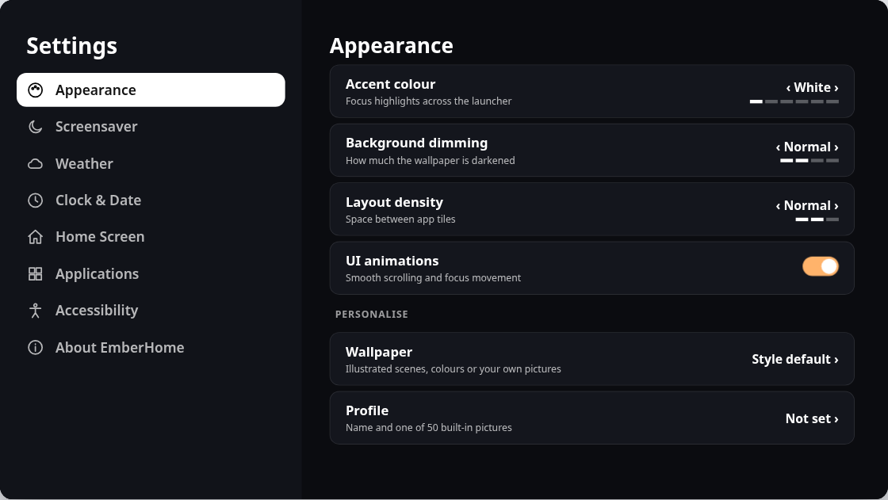
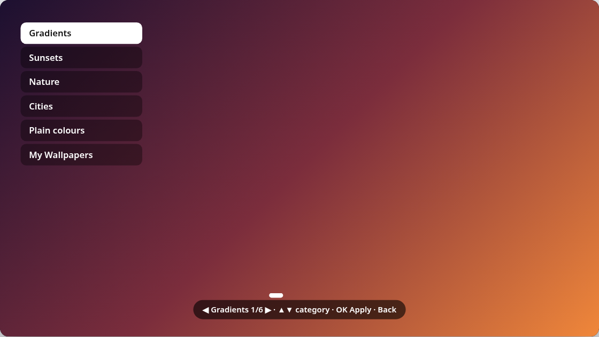
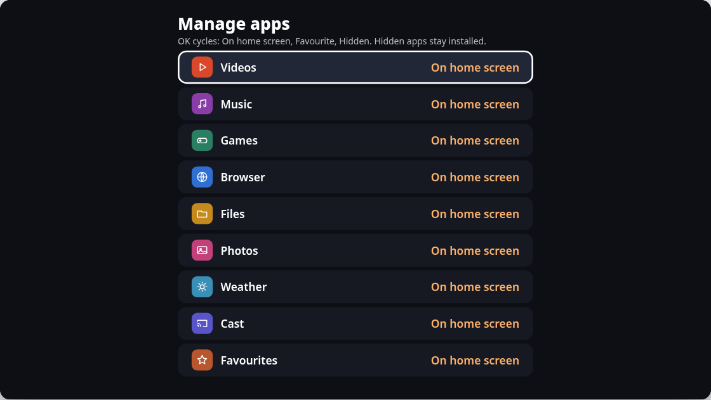
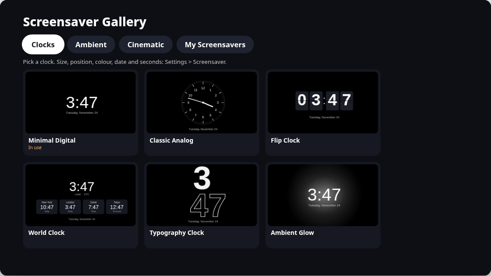
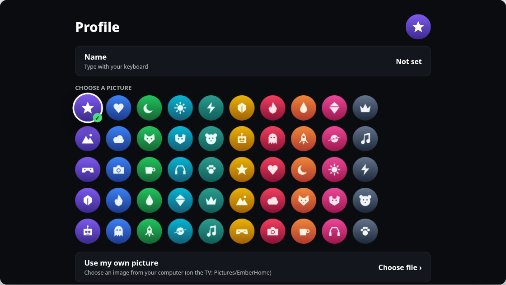

# EmberHome

**A remote-friendly home-screen launcher for Android TVs and streaming devices.**

EmberHome is an independent launcher project focused on a clean TV experience and practical D-pad navigation. This repository is the public home for the project, its active source archive, automated builds, and preserved historical editions.

> **Development direction:** Existing EmberHome builds have supported Android 4.4.4 and newer. The Android 4.4.4-compatible line is now being deprecated. Future active development is moving to **Android 6.0 (API 23) and newer**.

## Getting EmberHome

### Download on your TV with Downloader

1. Install and open the **Downloader** app on your Android TV or streaming device.
2. Enter the EmberHome Downloader code:

   **7686858**
3. Select **Go** and wait for the EmberHome downloads page to load.
4. Choose a version that matches your device and download the APK.
5. Open the downloaded APK and follow Android's installation prompts. If prompted, allow Downloader to install unknown apps.

You can also open the [EmberHome Downloads page](https://iy367-ux.github.io/EmberHome/) directly.

### Download from GitHub

Visit [GitHub Releases](https://github.com/iy367-ux/EmberHome/releases) and download the APK attached to the version you want. Prefer a stable release for everyday use. Pre-releases and development builds may contain bugs.

**Build status:** GitHub Actions can produce debug/development APKs. An Actions artifact is a test build, not automatically a signed production release. Treat a build as stable only when it is explicitly published as a stable GitHub Release.

### Install using ADB

Enable network ADB on your TV/device, connect your computer to the same network, then run:

```bash
adb connect <TV_IP_ADDRESS>:5555
adb install -r EmberHome.apk
```

Press **Home** on the remote and select EmberHome when the device offers a launcher choice. The exact default-launcher steps vary by manufacturer and Android version.

**Safety note:** Do not disable or remove your device's stock launcher as a routine installation step. Keep a way to return to the original home screen.

For more detailed instructions, see the [Installation Guide](docs/INSTALLATION.md).

## Compatibility

- **Existing editions:** Android 4.4.4 (KitKat / API 19) and newer, depending on the edition and device.
- **Legacy line:** Android 4.4.4 support is being phased out. Legacy builds are preserved for existing compatible devices, but should not be expected to receive new features or ongoing maintenance.
- **Future active development:** Android 6.0 (API 23) and newer.

Android TV and Amazon Fire TV devices can differ in their launcher, screensaver, permissions, and system-settings behaviour. Compatibility with a particular model should be confirmed by testing; a successful APK build does not prove every device feature works.

## Screenshots

A look at EmberHome's home-screen designs, personalization options, and settings.

| Home experiences | |
| --- | --- |
| **Classic Home**<br> | **Ember Dock**<br> |
| **Cinema Rail**<br> | **Glass tvOS**<br> |
| **Google TV style**<br> | **Settings**<br> |
| **Wallpapers**<br> | **Manage Apps**<br> |
| **Screensaver Gallery**<br> | **Profile**<br> |

All screenshots are stored in [`docs/assets/`](docs/assets/) in this repository.

## Source and building

The active v2.0.0 project is currently stored as [`source/EmberHome-v2.0.0.zip`](source/EmberHome-v2.0.0.zip). GitHub Actions extracts it into a temporary directory and builds it without overwriting repository files.

To build locally:

1. Download and extract the source archive.
2. Open the extracted Android project in Android Studio, or use a compatible Java, Gradle, and Android SDK installation.
3. Run:

```bash
gradle assembleDebug
```

The debug APK is generated under `app/build/outputs/apk/debug/` in the extracted project.

## Repository map

| Location | Purpose |
| --- | --- |
| `source/` | Active v2.0.0 source archive used by CI |
| `legacy/android-4.4.4/` | Earlier Android 4.4.4-compatible project, preserved for reference |
| `.github/workflows/` | Automated APK build and release workflow |
| `docs/BRANCHES.md` | What each development and legacy branch is for |
| `docs/INSTALLATION.md` | Step-by-step installation instructions |

## Branches and project history

The `main` branch is the official public branch. Historical device ports and experiments are kept separate so they cannot accidentally become the current release. See [Branch guide](docs/BRANCHES.md) before choosing a branch.

## Downloader version picker

A TV-friendly version selector is available at [EmberHome Downloads](https://iy367-ux.github.io/EmberHome/). Enter Downloader code **7686858** to open it from the Downloader app. The selector lists versions 2.0.0, 1.5.0, and 1.0.0, and enables downloads only when a matching public GitHub Release contains an APK asset. See [Downloader setup](docs/DOWNLOADER.md) for publishing and maintaining the page.

## Reporting a problem or suggesting an idea

- [Submit user feedback](https://github.com/iy367-ux/EmberHome/issues/new/choose) — for anyone using a stable, beta, preview, or development build.
- [View existing issues and feedback](https://github.com/iy367-ux/EmberHome/issues).

When reporting a problem, include your device model, Android version, EmberHome version, what happened, and steps to reproduce it. Attach screenshots or logs only after removing personal information.

## Project status

EmberHome is evolving. Features, supported devices, and release availability may change. Please read the compatibility notes before installing and do not treat an experimental branch or debug artifact as a stable release.

---

Made by [iy367-ux](https://github.com/iy367-ux).
